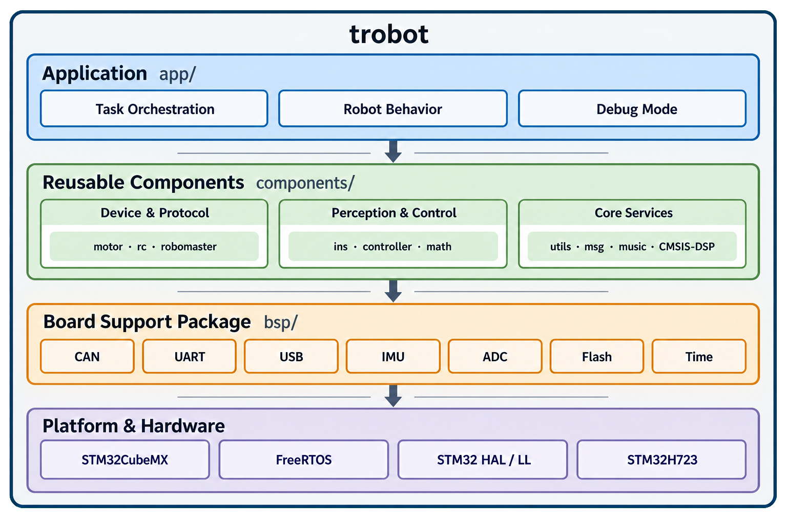

# TRobot

**T**GU **R**obot: The next robot embedded development framework.

## 快速开始

构建需要 Git、STM32CubeMX、CMake 3.22+、Ninja 和 Arm GNU Toolchain（`arm-none-eabi-gcc`）。

```sh
git clone --branch dev --recurse-submodules https://github.com/lym12321/trobot.git
cd trobot
```

用 STM32CubeMX 打开 `trobot.ioc`，点击 **Generate Code** 生成外设代码和 CMake 预设。工程使用 CubeMX 6.18.1 和 STM32Cube FW_H7 V1.13.0。如果 CubeMX 覆盖了 `STM32H723XG_FLASH.ld`，恢复仓库中的链接脚本再构建。

```sh
cmake --preset Debug
cmake --build --preset Debug
```

固件和链接映射分别位于 `build/Debug/trobot.elf` 和 `build/Debug/trobot.map`。构建优化版时，将两条命令中的 `Debug` 换成 `Release`。在 CLion 中也可以直接启用对应的预设。[CLion 配置图](assets/Cmake.png)

连接 ST-Link 并安装 OpenOCD 后，可直接烧录并校验固件。

```sh
cmake --build --preset Debug --target flash_and_verify
```

普通启动后，板级初始化成功且惯导就绪时，状态灯开始循环变色。持续亮红灯表示仍有板级硬件初始化故障。

## 添加应用任务

FreeRTOS 的 `entrance` 线程调用 `app_entrance()`。普通启动时，入口先初始化板级硬件，再等惯导就绪。要运行 `example_task`，取消入口中 `os::task::static_create(...)` 那一行的注释，重新构建并烧录。[应用入口](app/main/main.cc) · [示例任务](app/task/example_task.cc)

- `app/` 放机器人行为和任务编排。
- `components/` 放可复用的驱动和算法。新组件导出 `components::<name>` CMake 目标，构建时自动发现。[ST7789 显示组件示例](components/display/README.md)
- `bsp/` 封装板载外设，通过 `bsp_*` C 接口供应用和组件调用。[BSP 公共头文件](bsp/include/bsp)



## 读取板载日志

默认固件把 `WARNING` 和 `ERROR` 写入板载 Flash。按住 **USER** 再按 **RESET**，电脑会识别出一个只读 USB 磁盘。复制 `LOG.TXT`，弹出磁盘后松开 **USER**，再按 **RESET** 返回应用。如果只看到 `ERROR.TXT`，请在复位前查看[日志导出说明](docs/board-debug.md#从板上复制日志)。

串口终端、USB CDC、RTT 和 GDB 的用法见[板上调试指南](docs/board-debug.md)。

## 可选组件

需要 DSP 算法时，在项目根目录安装 **CMSIS-DSP**。

```sh
git submodule add -f https://github.com/lym12321/tr_comp_cmsis_dsp.git components/cmsis-dsp
git -C components/cmsis-dsp checkout 9d62eb4
```

需要接收裁判系统数据时，安装 **RoboMaster 通信组件**。

```sh
git submodule add -f https://github.com/lym12321/tr_comp_robomaster.git components/robomaster
git -C components/robomaster checkout 4b1f16d
```

[DM-MC-Board02 用户手册 V1.1](docs/DM-MC-Board02_User_Manual_V1.1.pdf) · [应用开发指南](docs/agent-development.md) · [仓库约定](AGENTS.md)
